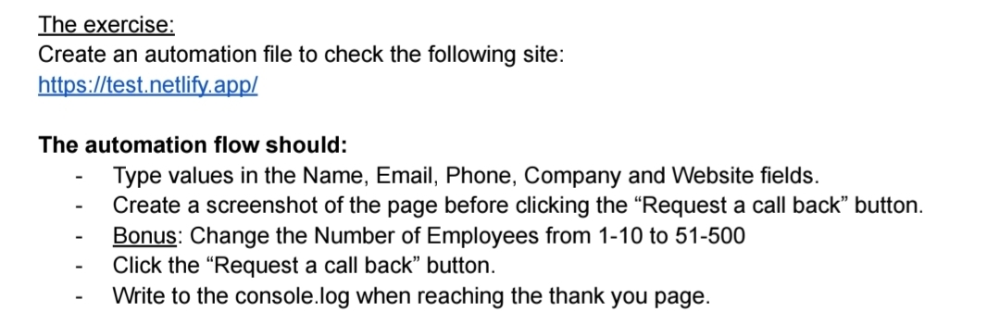

# jones-aqa

Playwright + pytest + Allure automation for the **"Request a call back"** lead form.
Page Object Model, typed Python, data-driven cases, and an offline copy of the page's markup so
the suite runs anywhere, including CI.

## Resources

| | |
| --- | --- |
| **Billing widget review (UI mock-up Q&A)** | [docs/billing-widget-review.md](docs/billing-widget-review.md) |
| **Architecture** | [docs/architecture.md](docs/architecture.md) |

## The exercise



| Requirement | Where |
| --- | --- |
| Type Name, Email, Phone, Company, Website | `CallBackPage.fill_contact_details` |
| Screenshot before clicking "Request a call back" | `CallBackWorkflow._screenshot_before_submit` → `reports/screenshots/before_submit_*.png` + Allure attachment |
| **Bonus:** Number of Employees 1-10 → 51-500 | Case `CB2`: checks the default is `1-10`, then `CallBackPage.select_employees("51-500")` |
| Click "Request a call back" | `CallBackPage.submit` |
| console.log on the thank-you page | `ThankYouPage.log_arrival`: browser `console.log` + Python log, asserted by the test |

## Quick start

```bash
# 1. Python environment
python -m venv .venv && source .venv/bin/activate
pip install -e ".[dev]"

# 2. Playwright browser
playwright install --with-deps chromium

# 3. Run against the real site (default env=prod)
make test

# …or fully offline against the bundled mock site
make test ENV=local

# 4. Open the Allure report
make allure-serve
```

Optional: `cp .env.example .env` to change defaults (`ENV`, `JONES_BASE_URL`, mock port).

## Layout

```txt
.
├── docs/                # Architecture, billing-widget review, exercise images
├── fixtures/            # pytest fixtures (env + mock site, browser, call-back)
├── pages/               # Page Object Model
│   ├── base/
│   └── jones/           # call_back, thank_you
├── reports/             # Allure, traces, screenshots (gitignored)
├── resources/
│   ├── mock_site/       # Offline copies of the live form and thank-you pages
│   └── test_data/       # call_back_cases.jsonc + <env>/valid_leads.csv, invalid_leads.csv
├── tests/               # Test suites only
├── utilities/           # env, driver, Allure, JSONC + schema, mock server
└── workflows/           # Multi-page business flows
```

## Test cases

| Suite | Data | What it checks |
| --- | --- | --- |
| `test_request_call_back.py` | `test_data/call_back_cases.jsonc` (CB1, CB2) | The exercise flow: fill, bonus 1-10 → 51-500, screenshot, submit, console.log on the thank-you page |
| `test_valid_submissions.py` | `test_data/<env>/valid_leads.csv` | Every row reaches the thank-you page (heading, subheading, *Back to Home*). The GET query echoes **every** typed value back, and console.log fires |
| `test_invalid_submissions.py` | `test_data/<env>/invalid_leads.csv` | Empty form, each required field missing, and bad email/website values. The form stays put, validation flags **exactly** the listed inputs with a message, and no console.log |
| `test_label_focus.py` | the 5 text inputs | Before the click, every label background is `none`. After clicking an input, its label is `rgba(122,184,147,1)` and the others stay `none` |

### Data by env

The CSVs are picked by `--env`, from `resources/test_data/<env>/`:

| Env | `valid_leads.csv` | `invalid_leads.csv` |
| --- | --- | --- |
| `local` | 5 rows: all four size buckets, international phone, path+query website, non-Latin name, optional fields blank | 13 rows |
| `prod` | 3 rows, kept small so the live lead inbox isn't flooded | 13 rows (validation runs in the browser, so nothing reaches the backend) |

`{run_id}` in any value expands to a unique, timestamped id per run. A row with a `known_issue`
documents something the site *should* reject but doesn't. It runs as a **strict xfail**, so the
suite turns red the day it's fixed and the row can be moved on:

- **E12**: name of only spaces passes `required`.
- **E13**: phone `call me maybe` is accepted.

Both files are schema-checked at collection: column set, unique ids, employee bucket, required
fields, and `invalid_fields` ⊆ the form's input ids.

## Findings on the live page

Found while automating, from the page's HTML:

| Sev | Finding |
| --- | --- |
| High | **PII in the URL.** `<form action="thank-you.html">` has no `method`, so it submits as `GET`. Name, email and phone end up in the thank-you URL, browser history, server/CDN logs, analytics and the `Referer` header sent to third parties. Use `method="post"` (or Netlify Forms). |
| Medium | **Placeholder contradicts validation.** Website shows `example.com`, but `type="url"` rejects it without `https://`. A visitor who follows the hint can't send the lead at all (E9). |
| Medium | **Blank names pass.** A name made only of spaces satisfies `required` (E12, xfail). |
| Medium | **No spam protection.** No honeypot, CAPTCHA or Netlify `data-netlify-honeypot`, so the lead form is open to bot submissions. |
| Low | **Phone isn't validated.** `type="text"` with no `pattern`, so any text is accepted (E13, xfail), and mobile shows a full keyboard instead of `type="tel"`'s number pad. |
| Low | **Broken and insecure assets.** The Google Fonts link is `http://` (mixed content, blocked on HTTPS). The Font Awesome link has `rel="stylesheet&quot;"`, so it never loads. |
| Low | The label sits after the input (`inplace-label`), so on-screen reading order is input-then-label. `© Acme 2013` is stale. |

## Make targets

| Target | Description |
| --- | --- |
| `make install` | Editable install with dev deps |
| `make browsers` | `playwright install --with-deps chromium` |
| `make test` | Full suite |
| `make test-smoke` | `-m smoke` |
| `make test-regression` | `-m regression` |
| `make test-call-back` | `-m call_back` |
| `make mock-site` | Serve the mock site on :8765 for manual poking |
| `make allure-serve` | Open Allure report from last run |
| `make lint` / `make format` | black + isort + flake8 |

Make variables: `ENV` (default `prod`), `HEADED=1`, `SLOWMO=250`, `WORKERS=4`.

## pytest CLI

```bash
pytest \
  --env=local \          # local | prod
  --browser=chromium \   # chromium | firefox | webkit
  --headed \             # visible browser
  --slowmo=250 \         # ms delay between actions
  --keep-traces \        # keep Playwright traces for passing tests too
  -n=4                   # parallel workers (pytest-xdist)
```

## Artifacts

- Pre-submit screenshot: `reports/screenshots/before_submit_{run_id}.png` (every run)
- On failure: screenshot, URL and DOM in Allure, plus a trace in `reports/traces/{case}_{ts}.zip`
- Browser console log: attached to every test in Allure
