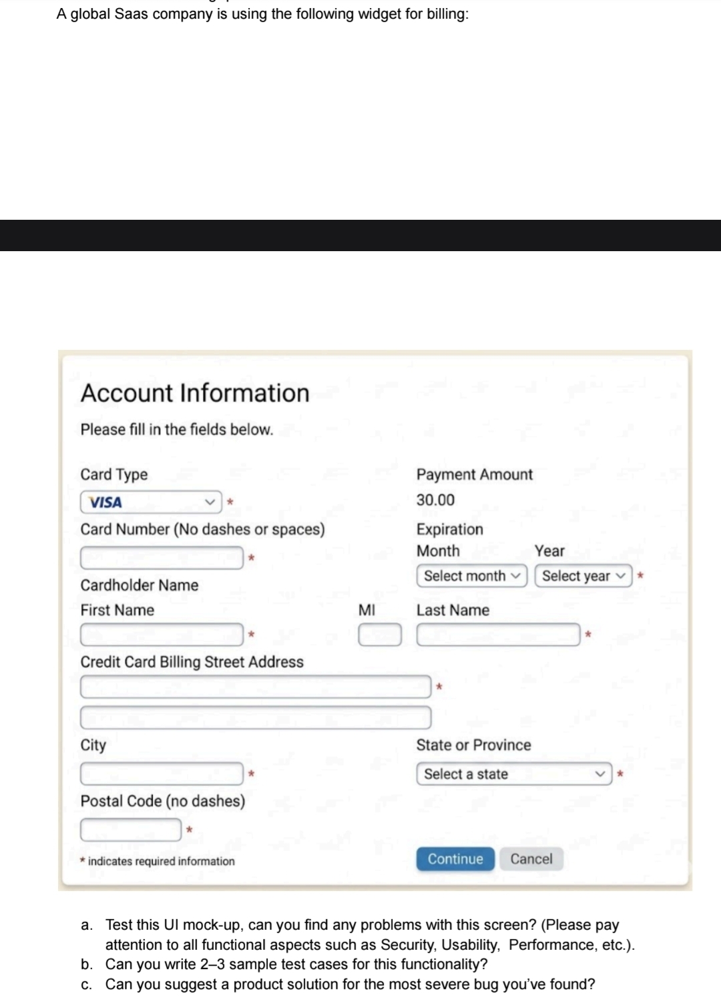

# Billing widget — UI mock-up review

> **Context.** A global SaaS company uses the "Account Information" widget below for billing:
> card type, card number, expiry, cardholder first / MI / last name, two billing street
> lines, city, state or province, postal code (no dashes), a read-only payment amount of
> `30.00`, and **Continue** / **Cancel** buttons.
>
> - **a.** Test this UI mock-up. What problems can you find? (Security, usability, performance, etc.)
> - **b.** Write 2–3 sample test cases for this functionality.
> - **c.** Suggest a product solution for the most severe bug you found.

---

## a. Problems found

Severity: **S1** blocks payment or creates a security / compliance risk ·
**S2** major friction, wrong data or lost revenue · **S3** minor / polish.

### Functional: the "global" problem

| # | Sev | Problem | Why it matters |
| --- | --- | --- | --- |
| F1 | **S1** | **No Country field.** The address is assumed to be US/Canada. | A *global* SaaS cannot bill most of its market. The processor also can't run AVS (Address Verification) without a country, so more legitimate cards get declined. |
| F2 | **S1** | **State or Province is required** and is a single fixed dropdown. | Most countries (UK, Israel, Singapore and others) have no state. Those customers can't submit the form, or they pick a fake state and the billing data is wrong. |
| F3 | **S1** | **Postal Code is required and says "no dashes".** | Many valid formats break: UK `SW1A 1AA` (space), Canada `K1A 0B1`, Japan `100-0001`, Poland `00-950`, Portugal `1000-001`, Brazil `01310-100` (dashes are part of the code). Some countries, such as UAE and Hong Kong, have no postcode at all. |
| F4 | S2 | **Payment amount `30.00` has no currency** and no description of what is being bought (plan, period, tax/VAT). | USD 30 vs. ILS 30 vs. JPY 30. Customers can't tell what they're paying for, which leads to chargebacks and support tickets. Missing VAT/GST breaks invoicing in the EU, UK and other regions. |
| F5 | S2 | **No CVV / CVC field.** | The processor can't verify the card is present. This raises fraud, decline rates and interchange fees, and many acquirers reject card-not-present transactions without it (see Security). |
| F6 | S2 | **Card Type dropdown is redundant** and can contradict the number (VISA selected + Amex `3…` number). | The brand can be detected from the first digits (BIN/IIN). A mismatch either blocks a valid card or sends a wrong value to the processor. The visible list probably leaves out regional schemes (UnionPay, JCB, RuPay, Isracard, Elo…). |
| F7 | S2 | **Card number "No dashes or spaces"** puts formatting on the user. | Pasting from a password manager (`4111 1111 1111 1111`) fails. The form should accept the value, strip non-digits, group digits as you type, enforce length per brand (Amex 15, most 16, some 19) and run a Luhn check. |
| F8 | S2 | **Expiration:** the required asterisk appears only after *Year*. The Month dropdown shows no required marker. There's no rule against past dates. | Inconsistent required markers. Testers must cover the boundaries: the current month is valid, the previous month is expired, and the year list should start at the current year and run about 10–20 years ahead. |
| F9 | S2 | **Cardholder name split into First / MI / Last.** | Cards carry one name line. Many cultures have no middle initial, a single name (mononyms), or the family name first. Hyphens and apostrophes (`O'Brien`, `Jean-Luc`) must be accepted. Splitting the name changes what gets sent to 3-D Secure / AVS. |
| F10 | S3 | **Second street line has no label** ("Apt, suite, unit (optional)"). | Screen readers announce an unlabeled edit box. Users don't know what belongs there. |
| F11 | S2 | **"Continue" is ambiguous.** Does it charge the card now or go to a review step? | Users need to know when money moves. A button such as **Pay 30.00 USD** or **Review order** removes the doubt. |
| F12 | S2 | **"Cancel" sits right next to the primary action**, with no confirmation and no stated outcome. | One mis-click throws away everything the user typed. Where does Cancel go: the previous step, the plan page, or does it close the window? |
| F13 | S3 | Title **"Account Information"** for a billing/payment form, and generic help text "Please fill in the fields below." | Misleading. It should say *Payment details* / *Billing address* and show the plan being paid for. |
| F14 | S3 | **"\* indicates required information"** appears at the bottom. | Users read this after they've already filled the form. Convention puts it at the top. |

### Usability and accessibility

| # | Sev | Problem |
| --- | --- | --- |
| U1 | S2 | **Layout and tab order are muddled.** The right column (Payment Amount, Expiration) sits between Card Number and Cardholder Name, so likely keyboard and screen-reader order is *Card Type → Card Number → Month → Year → First → MI → Last*, which doesn't match visual order on smaller screens. |
| U2 | S2 | **Required state is shown only by a red asterisk** placed *outside* the field. Color-only cues fail WCAG 1.4.1. Each required field needs `aria-required` / `required` and text, not just a symbol. |
| U3 | S2 | **No inline validation or error states** are designed. Where do errors appear, what do they say, and is focus moved to the first error? |
| U4 | S3 | **Low-contrast grey "Cancel" button**, and input borders may fail WCAG 1.4.3 / 1.4.11 contrast. |
| U5 | S2 | **No autofill hints.** The form should use `autocomplete="cc-number"`, `cc-exp-month`, `cc-exp-year`, `cc-name`, `cc-csc`, `address-line1`, `postal-code`, `country`, plus the right `inputmode="numeric"`. Without them, browser and password-manager autofill breaks, and mobile shows a full keyboard instead of a number pad. |
| U6 | S3 | **Field widths don't match content.** MI is fine, but Postal Code is too short for longer international codes, and the State dropdown is wider than needed. |
| U7 | S2 | **Not responsive.** The two-column layout won't fit on mobile, where many SaaS customers pay. |
| U8 | S3 | **No localization:** month names vs. numbers, date order, translated labels, right-to-left languages (Hebrew/Arabic), non-Latin characters in address fields. |
| U9 | S3 | **No trust signals** (lock icon, "Secured by …", accepted-card logos) and no link to terms or the refund policy. These lower conversion. |

### Security and compliance

| # | Sev | Problem |
| --- | --- | --- |
| S1 | **S1** | **Raw card number is typed into a first-party form.** Unless the fields are processor-hosted iframes (Stripe Elements, Adyen, Braintree Hosted Fields), the company's servers receive the PAN. That puts the whole app in **PCI-DSS SAQ D** scope instead of SAQ A. |
| S2 | **S1** | **No CVV, and no 3-D Secure / SCA step.** EU/UK customers fall under PSD2 Strong Customer Authentication, India under RBI e-mandates. Without these, payments are declined or the merchant carries all fraud liability. |
| S3 | **S1** | **Client-side amount.** The `30.00` must never be read from the request. If it's a hidden field or JS value, a user can intercept the request and pay `0.01`. The server must price the order from the plan ID. |
| S4 | **S1** | **Double submission.** Double-clicking *Continue*, or retrying after a timeout, can charge twice. The form needs a disabled/loading button **and** a server-side idempotency key per payment attempt. |
| S5 | S2 | **Card testing / carding attacks.** An open billing form is used to validate stolen cards. It needs rate limits per IP/account/device, a CAPTCHA or risk scoring after N failures, and generic decline messages that don't reveal which field was wrong. |
| S6 | S2 | **Data handling.** The PAN must be masked after entry and never stored, logged, sent to analytics or session-replay tools (FullStory/Hotjar), or placed in URLs (a `GET` form). CVV must never be persisted. HTTPS + HSTS, CSRF token, `autocomplete` set correctly (not `off`). |
| S7 | S2 | **Injection.** Name, address and city are free text. They end up in invoices, emails and admin tools, so they need validation and output-encoding (stored XSS, CSV/formula injection in exports). |
| S8 | S3 | **Session handling.** The form needs a timeout while it sits open, and back/refresh after submit must not resubmit the payment. |

### Performance and reliability

| # | Sev | Problem |
| --- | --- | --- |
| P1 | S2 | **No loading or processing state.** Gateway calls take 1–10 s, and 3-D Secure takes longer. Without a spinner and a disabled button, users click again (see S4) or leave the page. |
| P2 | S2 | **Timeouts and retries are undefined.** If the gateway times out, did the charge happen? The UI needs an "unknown" state that reconciles through the idempotency key instead of telling the user "failed" and letting them pay twice. |
| P3 | S3 | **The State dropdown loads every subdivision up front.** With a country field it should be lazy-loaded per country, cached and served from a CDN. |
| P4 | S3 | **Load peaks.** Monthly renewals cluster on the 1st of the month, so billing endpoints need load tests at peak concurrency, with response-time SLOs (p95 < 2 s, excluding the gateway). |
| P5 | S3 | **Third-party scripts** (payment SDK, fraud, analytics) must load asynchronously and not block first paint for users far from the origin (global audience). |

---

## b. Sample test cases

### TC-01: Successful payment with a valid card and complete US address (happy path)

| | |
| --- | --- |
| **Priority** | P1 · Smoke |
| **Preconditions** | Logged-in account on a plan priced 30.00 USD. Sandbox gateway. |
| **Test data** | Card Type `VISA` · Card `4111111111111111` · Exp `12` / current year + 2 · CVV `123` (once added) · First `Jane` · Last `Doe` · Address `1 Market St` · City `San Francisco` · State `California` · Postal `94105` |

| Step | Action | Expected result |
| --- | --- | --- |
| 1 | Open the billing widget. | All fields are empty, the amount reads **30.00** and the currency is shown. Continue is enabled, or disabled until the form is valid. |
| 2 | Fill all required fields with the test data. Leave MI and address line 2 empty. | No validation errors appear. Optional fields are not flagged. |
| 3 | Click **Continue** once. | The button becomes disabled with a loading indicator and no second request can be sent. |
| 4 | Wait for the response. | A success/confirmation step appears. Exactly **one** 30.00 charge exists in the gateway sandbox. The DB/logs hold only a token and the last 4 digits (`1111`), never the full PAN or CVV. |
| 5 | Check email and the invoice. | The receipt shows the amount, currency, masked card `•••• 1111` and the billing address entered. |

### TC-02: Expiration date boundaries (current month accepted, past month rejected)

| | |
| --- | --- |
| **Priority** | P1 · Regression |
| **Preconditions** | Same as TC-01. Test runs with a known system date (for example 2026-10-20). |

| Step | Action | Expected result |
| --- | --- | --- |
| 1 | Open the Year dropdown. | The first option is the **current year** (2026). No past years are listed. The list covers at least 10 future years. |
| 2 | Pick Month `09`, Year `2026` (last month). Fill other fields validly. Click Continue. | Inline error *"Card is expired"* on the expiration field. No gateway call is made and focus moves to the field. |
| 3 | Change Month to `10` (current month). Click Continue. | Accepted, because a card is valid through the last day of its expiry month. Payment proceeds. |
| 4 | Leave Month empty, Year `2027`. Click Continue. | *"Month is required"*. Confirms Month is really required even though the mock-up shows the asterisk only after Year. |

### TC-03: International customer, UK billing address (shows the most severe bug)

| | |
| --- | --- |
| **Priority** | P1 · Regression · Expected to **fail** on the current design |
| **Preconditions** | Logged-in account on a GBP or USD plan. Sandbox gateway with AVS enabled. |
| **Test data** | Card `4000008260000000` (Stripe UK test Visa) · Name `Oliver Smith` · Address `10 Downing Street` · City `London` · Postal `SW1A 2AA` · Country `United Kingdom` |

| Step | Action | Expected result |
| --- | --- | --- |
| 1 | Look for a **Country** selector. | A Country field is present and defaults from account/locale. **Actual:** none exists → **Bug F1**. |
| 2 | Open **State or Province**. | For the UK the field is hidden or optional (*County, optional*). **Actual:** required, US/CA-only list → **Bug F2**. |
| 3 | Enter postal code `SW1A 2AA` (with the space). | Accepted and normalized. **Actual:** "no dashes" hint and a short field. A space or a 7-character code is likely rejected → **Bug F3**. |
| 4 | Submit. | Payment succeeds and AVS gets `GB` + postal code. |

> More coverage to add as one-liners: Luhn-invalid number · brand/number mismatch (VISA +
> `378282246310005`) · pasted number with spaces · 3-D Secure challenge success/fail/abandon ·
> declined card (generic message, no field leak) · double-click Continue → single charge ·
> amount tampering via proxy → server price wins · keyboard-only and screen-reader pass ·
> 320 px mobile layout · RTL locale · names with `'`, `-`, non-Latin characters ·
> Cancel with dirty form → confirmation.

---

## c. Product solution for the most severe bug

**Most severe bug: the address model is US-only (no Country, required State, "no dashes" postal
code) on a *global* SaaS billing form.** It's the one defect that **blocks revenue outright**.
A customer in the UK, Israel, Germany, Japan or Brazil either can't pay, or pays with made-up
address data. That causes AVS mismatches, more declines, wrong tax/VAT on invoices and
compliance exposure. It hits every non-North-American customer on every signup and renewal.

> The PCI/CVV issues (S1–S2) are just as severe from a *security* angle. The fix for those is
> to swap the raw card inputs for processor-hosted fields (Stripe Elements / Adyen), which
> also brings CVV, brand detection, Luhn and 3-D Secure for free. That should ship alongside
> the solution below.

### Proposed solution: country-driven, localized billing address

1. **Add a required `Country` field first in the address block.**
   - Pre-select it from the account's country, then browser locale, then geo-IP (the user can change it).
   - Make it a searchable list with ISO-3166 codes stored, not names.
2. **Make the rest of the address dynamic per country,** driven by open address metadata
   (Google `libaddressinput` / CLDR data, or the payment provider's address element):
   - **Region:** show the right label (*State*, *Province*, *County*, *Prefecture*, *Emirate*),
     the right options, and whether it's required. Hide it where it doesn't exist.
   - **Postal code:** use the local label (*ZIP*, *Postcode*, *PIN*, *CEP*), validate with a
     per-country regex, **accept spaces and dashes and normalize on the server**, and make the
     field optional or hidden where none exists.
   - Set field order and line labels per local convention (for example, postcode before city in
     DE/IL).
3. **Tie currency and tax to the country.** Show `30.00 USD` (or the local price), and calculate
   VAT/GST through the tax engine (Stripe Tax / Avalara) so invoices are compliant.
4. **Send `country` + `postal_code` to the gateway** so AVS / 3-D Secure work, and accept
   *"AVS unavailable"* results for countries where AVS isn't supported, rather than declining.
5. **Accessibility and autofill:** `autocomplete="country"`, `address-level1`, `postal-code`, with
   proper labels and errors linked to their fields.

### Rollout and success criteria

- **Quick fix (days):** make State optional when it's not US/CA, relax postal-code validation
  to `[A-Za-z0-9 -]{2,10}`, and add a basic Country select. This unblocks paying customers
  right away.
- **Full fix (sprint):** dynamic address schema behind a feature flag, rolled out by region
  and A/B-tested against the old form.
- **Metrics:** payment-form completion rate and checkout conversion by country,
  decline rate with reason `AVS_MISMATCH` / `INVALID_ZIP`, support tickets tagged
  "can't enter address", invoice/VAT correction requests. Target: completion rate outside
  the US matches the US rate within ±5 %.
- **Tests:** a parametrized suite over a country matrix (US, CA, GB, DE, IL, JP, BR, AE, IN)
  covering the label, required flag, postal-code valid/invalid samples and the AVS payload
  sent to the gateway.
